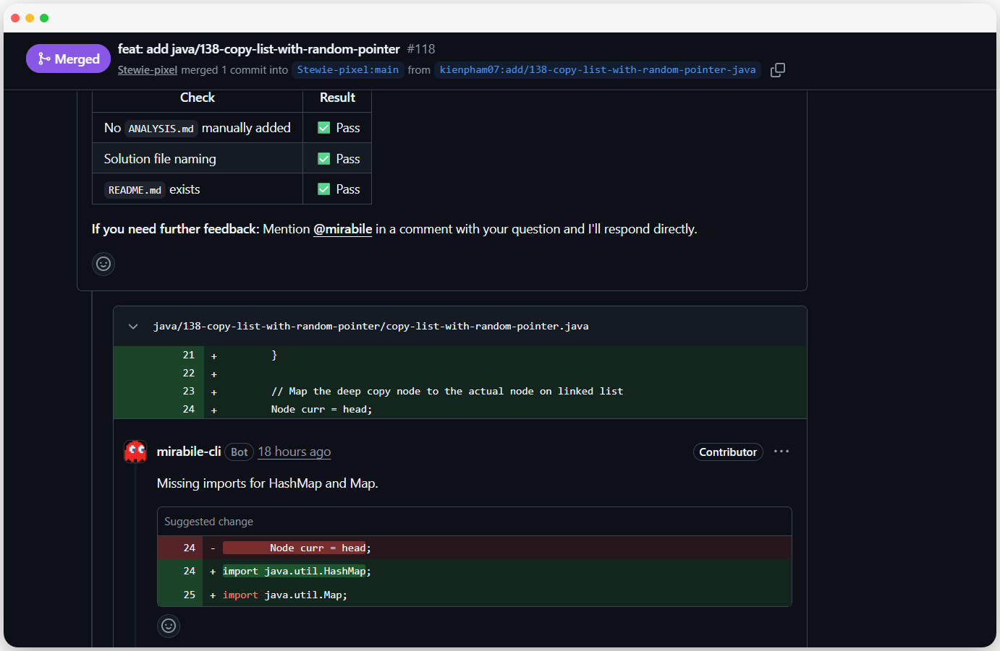

<div align="center">


# Claude with LeetCode

[](https://leetcode.com/u/hanchivi39/)
[](https://github.com/Stewie-pixel/claude-with-leetcode/actions/workflows/build-readme.yml)
[](https://github.com/Stewie-pixel/claude-with-leetcode)
[](https://github.com/Stewie-pixel/claude-with-leetcode)
[](https://github.com/Stewie-pixel/claude-with-leetcode/releases)
[](https://opensource.org/licenses/MIT)
[](https://github.com/sponsors/Stewie-pixel)

<language-badges />

A little assistant from Claude to help you learn daily LeetCode problems organised by DSA topic and difficulty.

</div>

> This repo hosts solutions to all problems found on [Leetcode](https://leetcode.com/problemset/) with the help of Claude. The site will be updated daily with new solutions under [problem list](https://github.com/Stewie-pixel/claude-with-leetcode#-problem-list)!

<br/>

Currently support these languages:

> Python, Java, JavaScript, C++, Go, C#, TypeScript, Rust, Kotlin, Ruby, C

Solutions are also welcome for any other _supported_ language on leetcode.com!

## 🎬 Demo



## 📊 GitHub Stats

<div align="center">


</div>

## 💻 Table of Contents

- [Overview & AI Mentorship](#-overview--ai-mentorship)
- [How to Use This Repository](#-how-to-use-this-repository)
- [Repository Structure](#-repository-structure)
- [Developer Quickstart & Local Setup](#-developer-quickstart--local-setup)
- [How the Automation Works](#-how-the-automation-works)
- [Features](#-features)
- [Roadmap](#-roadmap)
- [Share with the Community](#-share-with-the-community)
- [Contributing](#-contributing)
- [Thanks to our Contributors](#-thanks-to-our-contributors)
- [License](#-license)
- [Problem List](#-problem-list)

## 🧠 Overview & AI Mentorship

**Claude with LeetCode** is an AI-augmented DSA masterclass and multi-language solution archive. Rather than presenting cryptic one-line solutions, every problem added to this repository receives an in-depth, structured lecture generated by Claude AI saved as **`ANALYSIS.md`**.

### 🎓 The 3-Tier Breakdown in `ANALYSIS.md`

Each analysis avoids spoilers and focuses on building real algorithmic intuition:

1. **Concept & Real-World Analogy**: An intuitive explanation of the problem's underlying data structure or algorithm.
2. **Pattern Recognition Clues**: Concrete cues on *"When to use this pattern"* (e.g., subarray constraints, sorted input, state transitions).
3. **Reusable Template**: A clean Python boilerplate pattern you can adapt across similar problems.
4. **Graduated Solutions**:
   - **Approach 1 — Brute Force**: The naive solution establishing baseline correctness and exposing why it exceeds runtime or memory limits.
   - **Approach 2 — Intermediate Optimization**: The intuitive breakthrough that prunes redundant computation.
   - **Approach 3 — Most Optimal**: The final, interview-ready solution with complete time and space complexity explanations.
5. **Graduated Practice Problems**: Curated follow-up problems (easy → hard) to solidify the concept.

---

## 📖 How to Use This Repository

Whether you are preparing for coding interviews, studying for exams, or tracking the LeetCode Daily Coding Challenge, this repository provides multiple ways to learn:

### 1. Browse by Pattern & Topic
Jump to the [Problem List](#-problem-list) below. Problems are organized by algorithmic concept (e.g., Arrays, Dynamic Programming, Graphs, Backtracking, Two Pointers) and classified by difficulty:
- 🟢 **Easy**
- 🟡 **Medium**
- 🔴 **Hard**

### 2. Understand the Matrix Status
In the problem matrix:
- **`[✔️]` (Clickable Link)**: A solution and lecture exist! Clicking the checkmark opens the problem directory containing the code and Claude's `ANALYSIS.md`.
- **`❌` (Red Cross)**: No solution has been added for this language yet. This is a great opportunity to submit a PR!

### 3. Dedicated Study Tracks
In addition to the main language folders, check out specialized subdirectories:
- **`study_plan/leetcode75/`**: Solutions aligned with the LeetCode 75 blind curriculum.
- **`dcc/`**: Solutions for the LeetCode Daily Coding Challenge.
- **`contest/`**: Solutions and breakdowns from Weekly and Biweekly contests.

### 4. Recommended Study Workflow
```
Pick a problem by topic  ──►  Attempt on LeetCode (20-30m)  ──►  Read ANALYSIS.md intuition  ──►  Compare multi-language code
```

1. **Attempt First**: Try solving the problem on LeetCode before looking at the code.
2. **Study the Progression**: Open `ANALYSIS.md` to see the transition from brute force to optimal.
3. **Cross-Language Comparison**: Compare implementations across C++, Python, Rust, Go, Java, and TypeScript to see how language idioms differ.

---

## 📁 Repository Structure

```text
claude-with-leetcode/
├── {language}/                  # Main problem solutions by language (cpp/, python/, rust/, etc.)
│   └── {number}-{problem-slug}/ # Standardized problem folder (e.g., 1-two-sum/)
│       ├── README.md            # Problem statement, examples & constraints from LeetCode
│       ├── {slug}.{ext}         # Solution source code (e.g., two-sum.cpp, two-sum.py)
│       └── ANALYSIS.md          # Claude DSA Mentor deep-dive lecture & multi-tier solutions
├── dcc/{language}/              # Daily Coding Challenge archives
├── study_plan/                  # Curated tracks (e.g., study_plan/leetcode75/)
├── contest/                     # Contest solutions (weekly & biweekly)
├── docs/                        # Architecture diagrams and documentation
├── scripts/                     # Automation scripts (daily issues, badge updates)
├── .github/                     # GitHub Actions workflows and AI review bots
├── .problemSiteData.json        # Central metadata store for catalog problems
├── README_template.md           # Source template for README.md (edit this!)
├── README.md                    # Generated main README containing the full problem catalog
├── addProblem.js                # CLI utility to fetch problem metadata from LeetCode
├── updateTable.js               # Generates README.md tables from README_template.md
└── syncLeetcode.js              # Script to synchronize user submissions from LeetCode
```

---

## 🛠️ Developer Quickstart & Local Setup

Want to run the repository tools locally, fetch problem metadata, or contribute to automation?

### Prerequisites
- [Node.js](https://nodejs.org/) (v18.x or v20.x recommended)
- [Git](https://git-scm.com/)

### Installation
```bash
# Clone the repository
git clone https://github.com/Stewie-pixel/claude-with-leetcode.git
cd claude-with-leetcode

# Install dependencies
npm install
```

### Key Local Commands

| Command | Description |
| :--- | :--- |
| `node addProblem.js <number>` | Queries LeetCode's GraphQL API and adds problem metadata to `.problemSiteData.json` (e.g., `node addProblem.js 1`). |
| `node updateTable.js` | Rebuilds the problem completion tables and language badges from `README_template.md` into `README.md`. |
| `npm run test:review` | Runs unit tests for PR review suggestion utilities (`.github/scripts/suggestion-utils.test.mjs`). |

> [!IMPORTANT]
> **Editing the README:**
> `README.md` is automatically regenerated on every push and hourly cron. **Never edit `README.md` directly.** Instead, make your documentation edits in **`README_template.md`**, then run `node updateTable.js` to compile your changes into `README.md`.

---

## ⚙️ How the Automation Works

This repository is powered by a continuous GitHub Actions automation engine:

```text
                      ┌───────────────────────┐
                      │   LeetCode Catalog    │
                      └───────────┬───────────┘
                                  │
                        node addProblem.js / syncLeetcode.js
                                  │
                                  ▼
                      ┌───────────────────────┐
                      │  .problemSiteData.json│
                      └───────────┬───────────┘
                                  │
      ┌───────────────────────────┴───────────────────────────┐
      │                                                       │
      ▼                                                       ▼
┌────────────────────────┐                              ┌────────────────────────┐
│ Contributor Submits PR │                              │ Push to main / Cron    │
└───────────┬────────────┘                              └───────────┬────────────┘
      │                                                       │
      ▼                                                       ▼
┌────────────────────────┐                              ┌────────────────────────┐
│ pr-review.mjs AI Bot   │                              │ detectNewProblems.js   │
│ Automated code review  │                              └───────────┬────────────┘
│ & linting suggestions  │                                    │
└───────────┬────────────┘                                    ▼
      │                                                 ┌────────────────────────┐
      ▼ (Merged)                                        │ dsaMentor.js (Claude)  │
      │                                                 │ Generates ANALYSIS.md  │
      └────────────────────────────────────────────────►└───────────┬────────────┘
                                                              │
                                                              ▼
                                                        ┌────────────────────────┐
                                                        │ updateTable.js         │
                                                        │ Recompiles README.md   │
                                                        └────────────────────────┘
```

1. **Catalog Ingestion**: `addProblem.js` queries LeetCode's GraphQL API to record problem metadata (difficulty, topics, slug) in `.problemSiteData.json`.
2. **Automated PR Review**: Every pull request is inspected by an automated AI code review bot (`.github/scripts/pr-review.mjs`) for algorithmic correctness and adherence to standards.
3. **AI Mentor Lecture Generation**: When new solutions merge into `main`, GitHub Actions invokes `dsaMentor.js` to analyze the code and problem description, automatically committing `ANALYSIS.md`.
4. **Table Recompilation**: `updateTable.js` traverses all language directories, generates language badges, formats topic matrices, and updates `README.md`.

---

## 🚀 Features

### 🌐 Universal LeetCode Catalog Support

This repository organizes and compiles daily solutions for the entire universe of LeetCode questions, spanning everything from foundational array tasks to the most advanced dynamic programming problems found in weekly contests.

### 🤖 Intelligent AI Mentorship

Get granular, structural breakdown hints and optimal code logic recommendations from Claude without spoiling the core algorithmic logic upfront.

### 🔄 Multi-Language Synchronization

Automatically track and synchronize your multi-language solutions across comprehensive tech stacks including C++, Java, Python, Rust, and JavaScript.

### 📂 Automated Categorization

Zero manual cataloging required. The system automatically parses multi-topic tags and maps individual problems out into relevant, consolidated DSA pattern matrices.

## 🗺️ Roadmap

### 🔄 Continuous Solution Stream

- Maintain daily LeetCode coding challenge updates across C++, Java, Python, Rust, and JavaScript
- Comprehensive tracking and solution mapping for all Weekly and Biweekly programming contests
- Expand alternative optimal pattern variations for advanced dynamic programming structures

### 🛠️ Developer Tooling & Integration

- Mirabile CLI GitHub workflow integration to seamlessly guide developers through issue creation
- Standardized Pull Request onboarding automation to assist external contributors during code submission
- Implement automated execution verification hooks to validate runtime complexity statistics

## 📢 Share with the Community

If this project is helping you crush your technical interviews, share it with your network and help others level up their algorithmic skills.

<div align="center">

[](https://x.com)
[](https://reddit.com)
[](https://linkedin.com)
[](https://dev.to)
[](https://facebook.com)
[](https://instagram.com)

</div>

## 🤝 Contributing

Contributions are what make the open-source community such an amazing place to learn, inspire, and create. Any contributions you make are greatly appreciated!

### Quick Contribution Steps

1. **Find an unsolved problem**: Pick any `❌` from the [Problem List](#-problem-list) in your favorite language.
2. **Fork and branch**:
   ```bash
   git checkout -b add/{number}-{problem-slug}-{lang}
   ```
3. **Add your folder and files**:
   ```text
   {language}/{number}-{problem-slug}/
   ├── README.md       # HTML problem description from LeetCode
   └── {problem-slug}.{ext}
   ```
4. **Submit PR**: Open a pull request against `main`. Our AI review bot will review your submission, and on merge, `ANALYSIS.md` will be generated automatically!

For full conventions, coding standards, and step-by-step instructions, see our [Contributing Guide](./CONTRIBUTING.md).

## 💖 Thanks to our Contributors

A massive thank you to everyone helping maintain, optimize, and expand this data structure and algorithm sandbox.

[](https://github.com/Stewie-pixel/claude-with-leetcode/graphs/contributors)

## 📄 License

Distributed under the MIT License. See `LICENSE` for more information.

## ⚡ Problem List

<completion-tables />
